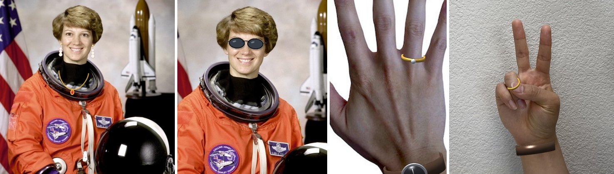

# drape

Try on jewellery, glasses and watches from **your own photos or 3D models**, live on your webcam. Everything
runs on your machine: no account, no upload, no cloud.



<sub>Portrait: NASA astronaut Eileen Collins (public domain). Hands: MediaPipe's test images (Apache-2.0). Items
are drape's own sample drawings and models. Note the ring's band disappearing behind the finger, the stone and
watch dial only on the back of the hand, and the earrings hanging straight down.</sub>

## What it does

Give drape a photo of an item (a product shot, or a picture you took on a plain background) or a 3D model.
It pins the item to the right part of you in the camera view and follows you as you move.

| Item kind | Sits on | Photo | 3D model |
|---|---|---|---|
| `necklace` | base of the neck; hair and your chin can cover it | yes | |
| `earrings` | both ear lobes, hanging straight down; the far one fades as you turn your head | yes | |
| `glasses` | nose bridge, in perspective as you turn and tilt your head | yes | |
| `ring` | ring finger of every visible hand | yes | yes |
| `wrist` (watch, bracelet, bangle) | just below the wrist | yes | yes |

Runs in real time: about 38 fps with a necklace, earrings and glasses (all trackers and hair segmentation on),
about 100 fps with a 3D ring and watch, at 1280x720 on an Apple M5 Pro.

## How it works

- **Tracking (learned):** Google's [MediaPipe](https://ai.google.dev/edge/mediapipe) models find 478 points on
  your face, 33 on your body and 21 on each hand, with depth, plus a hair/skin/clothes segmentation. They run
  on the CPU; the models (~30 MB, Apache-2.0) download once into `~/.cache/drape/models`.
- **Placement (geometry):** each kind of item has a rule for where it sits relative to those points, built in
  3D so it turns with you. Flat items are drawn as a plane in perspective; 3D models get a full 3D pose.
  The rules' proportions (how far below the ear a lobe is, how wide glasses are) are hand-set and tested on a
  few photos, not learned. Better numbers from more data are very welcome.
- **Things in front:** hair (from segmentation) hides a necklace, and earrings when the lobe is under hair;
  the chin hides a necklace when you look down. For 3D rings and watches, an invisible cylinder for the finger
  or wrist hides the back of the band, and neighbouring fingers can hide the ring.
- **Light:** items are dimmed or brightened and tinted to match the scene ("grey world" estimate), photo
  items cast a soft shadow, and 3D items are lit with simple metal and gem shading.
- **Cut-out:** a plain background is removed by flood-filling from the photo's edges; install `rembg` for
  busy backgrounds.

## Install

Needs Python 3.10+ and a webcam. Developed on macOS (Apple Silicon); Linux and Windows should work too.

```bash
git clone https://github.com/intotheabyss19/drape && cd drape
uv sync                                  # or: pip install -e .
uv run python examples/make_samples.py   # draws sample items (and a 3D ring and watch) into examples/items/
```

## Use

```bash
uv run drape live examples/items/                    # every item in a folder
uv run drape live ~/Downloads/kundan_necklace.jpg my_specs.png:glasses wedding_band.glb:ring
uv run drape photo me.jpg examples/items/gold_necklace.jpg -o me_with_necklace.jpg
```

Live keys: **1-9** put on / take off an item, **n / p** next / previous item of the same kind, **+ / -**
bigger / smaller, **s** save a snapshot to `~/Pictures/drape`, **f** flip the mirror view, **h** hide the help,
**q** quit. You can wear one item per kind at a time (say a necklace, earrings and glasses together).
`--simple` turns off occlusion, scene lighting and shadows.

On macOS the first live run asks for camera access for your terminal app.

### Your own items

- **Kind**: put it in the file name (`gold_necklace.jpg`, `ray-ban sunglasses.png`, `steel watch.jpg`), add
  `:kind` after the path, or use a sidecar file.
- **Background**: a PNG with transparency is used as is. Otherwise drape removes a plain background (white or
  grey product shots work well). For busy backgrounds, install the optional remover: `uv sync --extra rembg`.
- **Fine-tuning**: a sidecar `<image name>.json` next to the image can set the kind, the attach point and the
  size:

  ```json
  {"kind": "earrings", "anchor": [0.5, 0.05], "scale": 1.2}
  ```

  `anchor` is where on the item (fractions of its width and height) the body point goes: for earrings the
  hook, for a necklace the top centre of the chain, for glasses the bridge.

### 3D models (rings, watches, bracelets)

`.glb`, `.gltf`, `.obj`, `.stl` or `.ply`. drape works out which way the model faces on its own: the band's
axis is its thinnest direction, the stone or dial is the side that sticks out, and the inner radius sets the
size, so a ring fits your finger whatever units the model uses. If it guesses wrong, a sidecar `.json` can
say `{"kind": "ring", "axis": [0, 0, 1], "up": [0, 1, 0], "inner_radius": 9.0, "metallic": 0.9}` in the
model's own units. Colours come from the model's vertex/face colours or base material colour.

## Roadmap

Contributions are very welcome, especially on these:

- [ ] **Gloves**: warp a glove image over the whole hand (piecewise warp on the hand landmarks).
- [x] Occlusion by hair, chin and fingers; 3D head pose; scene lighting and shadows; 3D rings and watches.
- [ ] **Measured placement**: a small labelled photo set to fit the placement proportions and report accuracy.
- [ ] **Textures** on 3D models (currently colours only) and environment reflections for metals.
- [ ] **Clothes, live preview**: a 2D garment warp driven by body pose.
- [ ] **Clothes, realistic still**: freeze a frame and render it with a try-on diffusion model.
  [FASHN VTON 1.5](https://github.com/fashn-AI/fashn-vton-1.5) is Apache-2.0; other popular models
  (IDM-VTON, CatVTON, OOTDiffusion) are non-commercial and would only ever be optional downloads.
- [ ] **Control API** (CLI + MCP server) so voice assistants can say "try the gold one on me".
- [ ] A small GUI for picking items and saving looks.

## Develop

```bash
uv sync
uv run pytest
```

The pieces are small and separate: `anchors.py` (where items sit; pure 3D geometry, unit-tested with fake
landmarks), `items.py` (loading and cutting out photos), `render.py` (perspective warp, occlusion, light,
shadow), `mesh3d.py` (3D models: orientation, OpenGL rendering, finger occluders), `tracker.py` (MediaPipe),
`session.py` (what's worn, per-frame masks) and `cli.py`. 3D tests skip themselves where there's no OpenGL.

To add a new item kind: add its placement function to `anchors.py`, its default attach point to
`items.DEFAULT_ANCHOR`, the trackers it needs to `tracker.NEEDS`, file-name words to `items._KIND_WORDS`, and
a test.

## Licence

[Apache-2.0](LICENSE). MediaPipe and its models are Apache-2.0 too.
